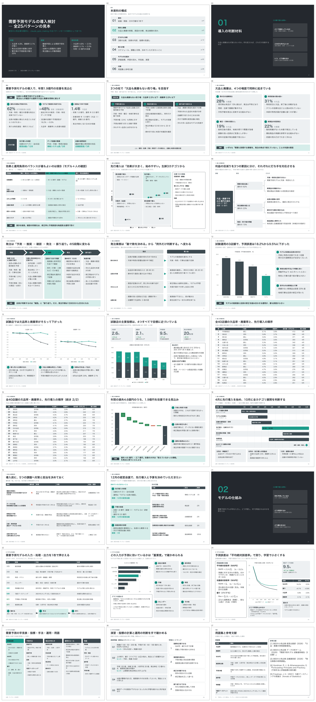
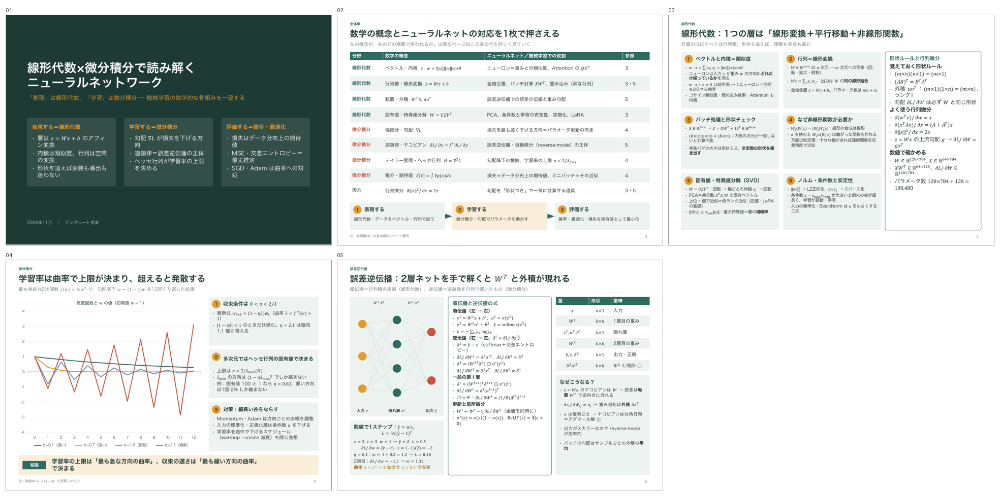
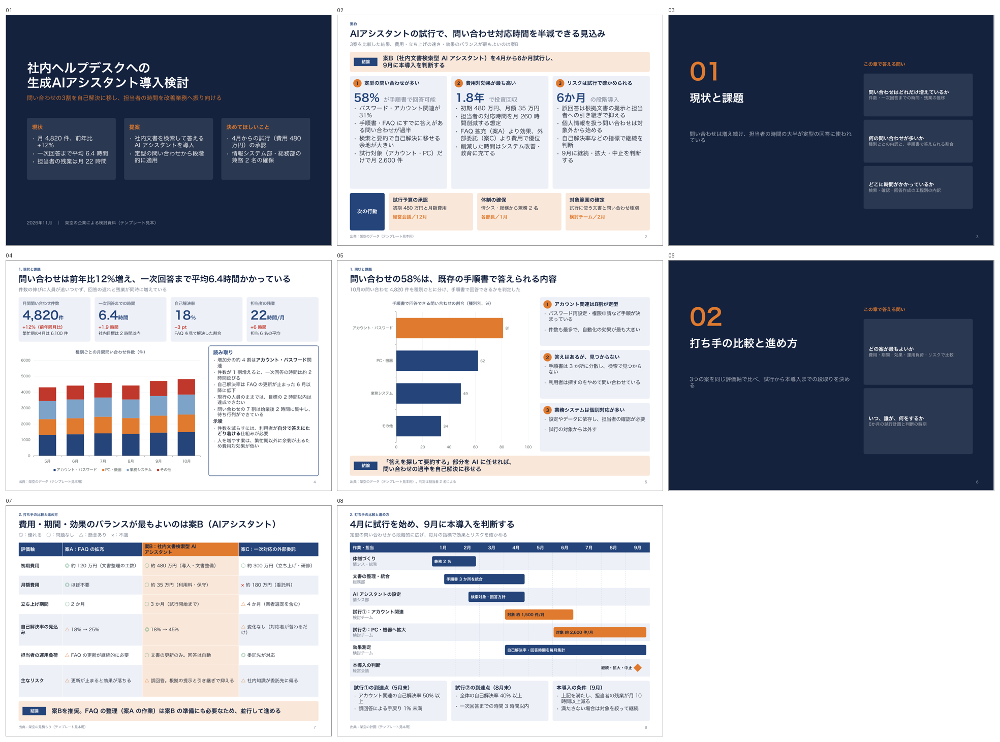

# claude_pptx_making

JSON で書いた仕様から、**密度が高く、PowerPoint でそのまま編集できる pptx** を生成するテンプレートキットです。
Claude に「〇〇の資料を pptx で作って」と頼むときに、毎回ゼロから組まずにこのキットを使うことを想定しています。

- 既定は **A4 横**・**ヒラギノ角ゴシック**・**読む資料向けの高密度**（本文 9.5〜14pt を自動調整）
- **25 パターン**（表紙・要約・比較・ロジックツリー・ガント・滝グラフ・早見表・演習など）
- グラフは PowerPoint の**ネイティブグラフ**、表は**ネイティブ表**。数値も見た目も PowerPoint で直せます
- テーマの配色・フォントは pptx のテーマにも書き込まれます
- 生成時に **はみ出し・空きすぎ・1〜2文字だけの最終行・壊れた図形** をページごとに検査し、入力は **JSON Schema** で検査します

全体の設計は [docs/DESIGN.md](docs/DESIGN.md) を参照してください。

## 見本

**全 25 パターンの見本**（Graphite テーマ、架空の事例）：[examples/catalog.json](examples/catalog.json) → [dist/catalog.pptx](dist/catalog.pptx)



| 学習・解説（Forest テーマ） | 報告・提案（Navy テーマ、架空の事例） |
|---|---|
|  |  |
| [examples/nn_math.json](examples/nn_math.json) → [dist/nn_math.pptx](dist/nn_math.pptx) | [examples/business_report.json](examples/business_report.json) → [dist/business_report.pptx](dist/business_report.pptx) |

## 使い方

Node.js 18 以降が必要です。

```bash
npm install
node src/build.js examples/catalog.json dist/catalog.pptx
```

```bash
node src/build.js --check deck.json      # 書き出さずに検査だけ
node src/build.js --catalog              # パターンとテーマの一覧
node src/build.js deck.json out.pptx --theme navy --size 16:9 --density present --font yu-gothic
npm test                                 # 回帰テスト（見本を全設定で生成して検査）
npm run schema                           # schema/deck.schema.json を書き出し直す
```

生成すると、ページごとに使った本文の文字サイズ・充填率・警告が表示されます。

```
 9  logic_tree     本文12       pt  充填  58%  利益の目減りを3つの要因に分け…
15  data_table     本文10.5     pt  充填 100%  全40店舗の欠品率・廃棄率と…
16  data_table     本文12       pt  充填 100%  全40店舗の欠品率・廃棄率と…（続き 2/2）
      ⚠ 「8月末：先行導入の到達点」の「生鮮の欠品率…」は最終行が1〜2文字になる可能性があります
```

入力の書き間違いは、どのスライドのどの項目かを示して止まります。

```
入力エラー:
  slides[0]「t」: 「cardz」はこのパターンにない項目です（書き間違い？）
  slides[1]「x」 の steps: 2 個以上必要です
```

見た目の確認（PDF・ページごとの PNG・一覧画像）:

```bash
pip install pymupdf Pillow
qa/render.sh dist/catalog.pptx render/
```

LibreOffice があればそれを、なければ Mac の PowerPoint を使って PDF にします。

### エディタでの補完

JSON の先頭に `"$schema": "./schema/deck.schema.json"`（パスは置き場所に合わせる）を書くと、VS Code などで項目名の補完と検査が効きます。

## パターン（25 種）

すべての通常ページに共通: `chapter`（章ラベル）、`title`（結論を示す見出し・体言止め・1行）、`lead`（リード文・1行）、`source`（出典）、`notes`（スピーカーノート）、`conclusion`（下端の結論帯）。

| ID | `pattern` | 用途 | 主な項目 |
|---|---|---|---|
| A1 | `cover` | 表紙 | `subtitle` `points[{title, body}]` `date` `org` |
| A2 | `agenda` | 目次 | `items[{title, body, page}]` `current` |
| A3 | `section` | 章扉 | `number` `lead` `points[{title, body}]` |
| A4 | `exec_summary` | 結論 → 根拠 → 次の行動 | `conclusion` `reasons[{title, body, stat}]` `actions[{title, body, owner, due}]` |
| B1 | `pillars` | 屋根・柱・土台 | `roof` `pillars[{title, body}]` `foundation` |
| B2 | `card_grid` | カードの格子（＋右にパネル） | `grid: "3x2"` `cards[{title, body, stat}]` `panel{title, body}` |
| B3 | `comparison` | 案 × 評価軸（◎○△× を自動で色分け） | `options[]` `criteria[{name, values[]}]` `recommend` |
| B4 | `matrix_2x2` | 2×2 マトリクス | `xAxis{label, low, high}` `yAxis` `quadrants[4]` `items[{label, x, y}]` `panel` |
| B5 | `logic_tree` | ロジックツリー（2〜3段） | `root{title, body}` `children[{title, body, children[]}]` `levels[]` |
| B6 | `process` | 矢羽根の手順（3〜6段） | `steps[{title, subtitle, body}]` `emphasize` |
| B7 | `before_after` | 現状 → あるべき姿 | `rows[{label, before, after}]` `beforeLabel` `afterLabel` |
| C1 | `chart_insight` | グラフ＋考察 | `chart{...}` `insights[{title, body}]` |
| C2 | `two_charts` | グラフ2つの比較 | `charts[2]` `sameScale` `insights[]` |
| C3 | `kpi_dashboard` | KPI タイル＋推移 | `kpis[{label, value, unit, delta, good, note}]` `chart` `panel` |
| C4 | `data_table` | 詳細表（自動で改ページ） | `headers[]` `rows[[]]` `widths[]` `align[]` `rowsPerPage` |
| C5 | `waterfall` | 滝グラフ（増減の分解） | `waterfall{start, steps[], endLabel, invert}` `insights[]` |
| D1 | `roadmap` | ガント＋到達点 | `periods[]` `tasks[{name, owner, start, end, label, highlight, milestone}]` `goals[]` |
| D2 | `issues_actions` | 課題 → 影響 → 対策 → 担当 | `rows[{issue, detail, priority, impact, action, owner}]` |
| D3 | `next_steps` | 決めてほしいこと＋行動一覧 | `decisions[{title, body, due}]` `actions[{title, owner, due}]` |
| E1 | `concept_map` | 対応表＋流れ | `headers[]` `rows[[]]` `tagColors{}` `flow[{title, body}]` |
| E2 | `chart_cards` | グラフ＋読み方＋カード | `chart` `panel` `cards[]` `grid` |
| E3 | `derivation` | 列にブロックを積む自由構成 | `columns[{width, blocks[{type: card / panel / table / chart / kpi / diagram / image / message}]}]` |
| E4 | `cheat_sheet` | 早見表（4〜8列） | `columns[{title, body}]` `highlight` |
| E5 | `exercises` | 演習（解答はノートへ自動）＋ロードマップ | `questions[{q, hint, answer}]` `roadmap[]` |
| F1 | `references` | 用語集・参考文献 | `glossary[{term, desc}]` `references[]` |

項目の正確な定義は [schema/deck.schema.json](schema/deck.schema.json)（生成元は [src/schema.js](src/schema.js)）、書き方の実例は [examples/catalog.json](examples/catalog.json) にあります。

### 文字の書き方（ミニ記法）

| 書き方 | 表示 |
|---|---|
| `**強調**` | 太字（中に数式も書ける） |
| `==強調==` | アクセント色の太字 |
| `[[3.0℃]]` | 主色の太字（数値の強調） |
| `$\\frac{1}{n}\\sum_{i} x_{i}^{2}$` | 文中の数式（TeX 記法）。PowerPoint の数式として書き出し、そのまま編集できる |
| `$$\\nabla_{\\theta} L = X^{\\top}(\\hat{y} - y)$$` | 段落全体を1つの数式として中央に置く（`body` の1要素にこれだけを書く） |
| 行頭 `- ` ／ `  - ` | 箇条書き ／ 2段目 |

本文（`body`）は文字列の配列で書き、1要素が1段落です。

### 数式（TeX 記法）

`$…$` の中は TeX（LaTeX の数式記法）で書きます。JSON ではバックスラッシュを `\\` と重ねます（`"$\\frac{a}{b}$"`）。書き出した数式は PowerPoint の数式エディタで編集でき、数式を表示できない環境では同じ内容の文字列が表示されます。

- 使える主な記法（TeX の表記。JSON では `\` を重ねる）：`x^{2}` `x_{i}` `f'` `\frac{a}{b}` `\sqrt{x}` `\sum_{i=1}^{n}` `\prod` `\int` `\max_{\theta}` `\exp` `\log` `\hat{y}` `\bar{x}` `\vec{v}` `\mathbf{x}` `\mathrm{d}` `\mathbb{R}` `\mathcal{F}` `\text{日本語}` `\left( … \right)` `\begin{bmatrix} a & b \\ c & d \end{bmatrix}`（`pmatrix` `vmatrix` `cases` も可）、ギリシャ文字、`\nabla` `\partial` `\cdot` `\times` `\le` `\approx` `\to` `\in` `\top` などの記号
- 関数名は `\log` `\exp` `\max` や `\operatorname{softmax}` と書く（`log` のままだと変数 l・o・g の積として斜体になる）
- 解釈できない数式は、`--check` でページと数式を示して警告する
- グラフの題名・項目名には数式を置けないため、`$…$` は文字列（`f′(x)` など）に置き換えて表示する

### グラフ

```json
{ "type": "bar", "title": "…", "categories": ["A", "B"], "series": [{ "name": "件数", "values": [3, 5] }],
  "highlight": 1, "min": 0, "max": 10, "unit": "件", "format": "0.0" }
```

`type`: `bar` `hbar` `stacked` `hstacked` `line` `area` `pie` `doughnut` `waterfall`。
系列が1つの棒グラフでは `highlight` の項目だけアクセント色になります。滝グラフは `{ "type": "waterfall", "start": {label, value}, "steps": [{label, value}], "endLabel": "…" }` で、費用や損失のように増えると悪いものは `"invert": true` で色を入れ替えます。

## 自動で行う調整と検査

| 内容 | しくみ |
|---|---|
| 文字サイズ | 同じページのカード同士で同じサイズにそろえ、枠に収まる最大のサイズを選ぶ。中身が少なく空きが目立つときは 2pt まで大きくする |
| 1〜2文字だけの最終行 | 0.5〜1pt 小さくして減らせるなら自動で調整。残ったものは警告 |
| 空きすぎ | 本文の充填率が 55% 未満のページ、45% 未満の枠を警告 |
| はみ出し | 最小サイズでも収まらない枠を警告 |
| 壊れた図形 | 大きさが負の図形（PowerPoint が「修復」を求める原因）があれば生成を止める |
| 入力 | JSON Schema で必須項目・型・項目名の書き間違いを検査 |
| 改ページ | `data_table` は入りきらない行を見出し付きで次ページへ。行はページ間でなるべく均等に分ける |

## 構成

```
src/
  build.js        CLI（入力検査・生成・検査結果の表示・壊れた図形の検出）
  schema.js       入力の仕様（JSON Schema）と日本語のエラー表示
  deck.js         用紙・テーマ・スライドレイアウト・見出し
  patterns/       25 パターン（1パターン1ファイル）と共通部品 _shared.js
  components.js   カード・パネル・結論帯・表・グラフ・KPI・手順・ガント・行・線
  blocks.js       列にブロックを積む配置（derivation で使用）
  markup.js       ミニ記法
  textfit.js      文字の収まりと1〜2文字の最終行の見積もり（ヒラギノの実測値）
  themes.js       forest / navy / graphite / burgundy
  theme-xml.js    pptx のテーマに配色と和文フォントを書き込む
  config.js       用紙・文字サイズ・フォント・字幅
schema/           deck.schema.json（エディタ用）
qa/               描画確認（render.sh, contact_sheet.py）
tests/            回帰テスト（npm test）
examples/         見本の入力 JSON（catalog = 全パターン）
dist/             見本の pptx
docs/             設計書と見本画像
skill/pptx-making Claude Code の Skill（SKILL.md と setup.sh・example.sh）
```

## Claude Code の Skill として使う（おすすめ）

Skill として登録すると、どのフォルダ・どの会話でも「〇〇の資料を pptx で作って」と頼むだけで、Claude がこのキットを使って作ります（汎用の pptx 作成手順でゼロから組むより速く、品質も安定します）。

```bash
git clone https://github.com/sibyl2501/claude_pptx_making.git ~/claude_pptx_making
mkdir -p ~/.claude/skills
ln -s ~/claude_pptx_making/skill/pptx-making ~/.claude/skills/pptx-making
bash ~/.claude/skills/pptx-making/scripts/setup.sh
```

- Skill の本体は [skill/pptx-making/SKILL.md](skill/pptx-making/SKILL.md)。目的の確認 → ストーリー → パターン選択 → JSON → 検査 → 画像で確認、の手順を Claude に渡します
- `setup.sh` はキットの取得・更新、Node の依存、描画確認用の Python 環境（`.venv`）をまとめて整えます。会話のたびに Claude が実行するので、キットは自動で最新になります（手元に変更があるときは更新しません）
- `scripts/example.sh <pattern>` は、全パターン見本から指定パターンの実例を1枚だけ取り出します（Claude が読む量を減らすため）
- キットの場所は環境変数 `PPTX_KIT_DIR` で変えられます（既定は `~/claude_pptx_making`）
- 登録後に開いた新しい会話から有効になります

## Claude に頼むとき（Skill を使わない場合）

このリポジトリの URL と、資料の目的・読み手・元の資料を渡して、次のように依頼します。

> claude_pptx_making の README・CLAUDE.md・examples/catalog.json を読み、1枚1メッセージでストーリーを組んでから、各ページに合う pattern を選んで JSON を書いてください。`--check` の警告（はみ出し・空きすぎ・1〜2文字の最終行）をなくしてから pptx を生成し、`qa/render.sh` で全ページを画像で確認してください。

Claude 向けの作業規約は [CLAUDE.md](CLAUDE.md) にあります。
